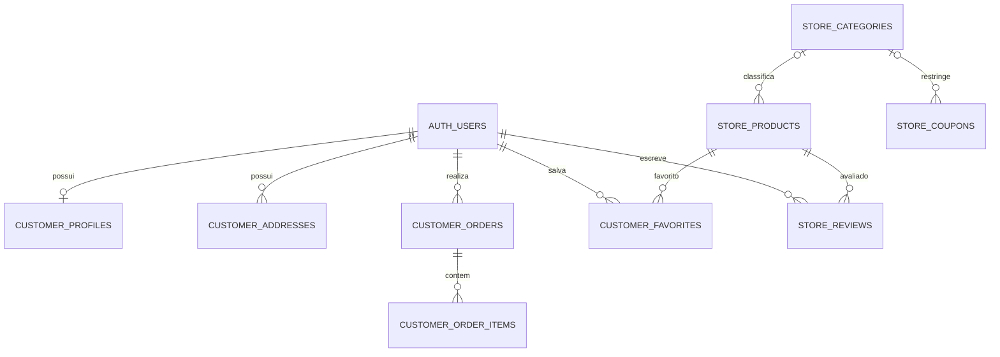

# Agenda 15 — Projeto lógico e físico / Introdução à SQL

**Projeto:** TechStore — e-commerce demonstrativo  
**Responsável:** Felipe Alexandre  
**SGBD em uso:** PostgreSQL 17, gerenciado pelo Supabase. O projeto **não usa MySQL**.  
**Verificado em:** 15/11/2026.

## Objetivo

Analisar a modelagem atual de um sistema real de portfólio, identificar relações entre tabelas e aplicar melhorias de integridade referencial, validação de atributos e indexação. O frontend utiliza React, TypeScript e GitHub Pages; o backend de dados e autenticação usa Supabase.

## Modelo conceitual (entidades de negócio)

- Usuário cadastrado: possui perfil, endereços, favoritos e pedidos.
- Categoria: agrupa produtos e pode restringir cupons.
- Produto: pertence opcionalmente a uma categoria; pode aparecer em favoritos, avaliações e itens de pedidos.
- Pedido: pertence a um usuário e contém itens.
- Avaliação: associada a usuário e produto.
- Cupom: oferece benefícios conforme regras e categoria opcional.
- Papéis de equipe e banners: recursos de administração e apresentação.

## Mapeamento para o modelo lógico

| Tabela real | Chave primária | Relacionamentos |
|---|---|---|
| `store_categories` | `id TEXT` | Referenciada por produtos e cupons |
| `store_products` | `id TEXT` | `category_id → store_categories.id` |
| `store_coupons` | `code TEXT` | `category_id → store_categories.id`, opcional |
| `customer_profiles` | `user_id UUID` | `user_id → auth.users.id` |
| `customer_addresses` | `id UUID` | `user_id → auth.users.id` |
| `customer_favorites` | `(user_id, product_id)` | `user_id → auth.users.id`; **nova FK:** `product_id → store_products.id` |
| `customer_orders` | `id UUID` | `user_id → auth.users.id` |
| `customer_order_items` | `id BIGINT` | `order_id → customer_orders.id` |
| `store_reviews` | `id UUID` | `user_id → auth.users.id`; **nova FK:** `product_id → store_products.id` |
| `staff_roles` | `user_id UUID` | `user_id → auth.users.id` |
| `store_banners` | `id TEXT` | Independente |

**Observação importante:** `customer_order_items.product_id` é um identificador histórico do catálogo, **sem FK deliberadamente** para permitir o histórico de uma compra simulada mesmo se o produto sair do catálogo. `product_name` e `unit_price` também são snapshots históricos do momento do pedido, e não cadastro duplicado por engano.

### DER simplificado (Mermaid)



## Modelo físico — melhorias efetivamente aplicadas

Em 15/11/2026 foram realizadas migrações **no banco ativo** do projeto:

- **2 novas FKs**: `customer_favorites.product_id` e `store_reviews.product_id` ligadas a `store_products.id`, ambas `ON DELETE CASCADE`.
- **9 novas validações `CHECK`**: nota de produto de 0 a 5; preço original não negativo; `features` do tipo array JSON; mínimos/limites de cupom não negativos; início de cupom anterior ao fim; desconto/frete não negativos; posição de categoria não negativa.
- **5 índices**: produto dos favoritos, produto dos itens de pedido, produtos ativos por categoria e preço, produtos destacados, categoria dos cupons.
- As **11 tabelas públicas já utilizavam RLS** e continuaram protegidas; não foram trocadas as políticas.
- Os **40 produtos** existentes foram preservados. Antes da migração, não havia referências órfãs em favoritos, avaliações e itens de pedido nas consultas de auditoria.

As migrações já foram executadas. **Não execute novamente** o roteiro SQL em um banco que já contenha essas restrições, pois `ADD CONSTRAINT` não é idempotente. O roteiro está em `docs/sql/agenda15-melhorias-aplicadas.sql` para consulta acadêmica e reprodução em um ambiente anterior à migração.

### Exemplos de SQL

```sql
-- DQL / consulta: produtos e suas categorias
SELECT p.id, p.name, p.price, c.name AS categoria
FROM public.store_products AS p
LEFT JOIN public.store_categories AS c ON c.id = p.category_id
WHERE p.active = TRUE
ORDER BY p.name;

-- DQL: itens e seus pedidos
SELECT o.reference, i.product_name, i.quantity, i.unit_price
FROM public.customer_orders AS o
JOIN public.customer_order_items AS i ON i.order_id = o.id;
```

DDL significa criação/alteração de estruturas (`CREATE`, `ALTER`). DML significa escrita/alteração de dados (`INSERT`, `UPDATE`, `DELETE`). `SELECT` é frequentemente classificado separadamente como DQL.

## Limitações e segurança

O projeto continua sendo **demonstrativo**: compras simuladas, sem pagamento nem entrega real. A aplicação React já estava conectada ao Supabase antes desta agenda; não foi reescrita sua interface para esta atividade. A regra de exclusão em cascata para avaliações e favoritos preserva consistência, mas exclui esses registros quando um produto é removido, algo que deve ser considerado nas decisões de negócio.

A auditoria pós-migração indicou **dois avisos preexistentes**: uma função `SECURITY DEFINER` exposta a usuários autenticados (revisar autorização antes de modificar) e a proteção contra senhas vazadas desabilitada. Não foram alterados nesta entrega. A leitura de avisos do banco está sujeita à configuração atual do Supabase.

- [Revisão de funções SECURITY DEFINER](https://supabase.com/docs/guides/database/database-linter?lint=0029_authenticated_security_definer_function_executable)
- [Proteção contra senhas vazadas](https://supabase.com/docs/guides/auth/password-security#password-strength-and-leaked-password-protection)

**Validação:** 11 restrições novas listadas como validadas (`convalidated=true`), 5 novos índices identificados e catálogo com 40 produtos, via consulta direta ao banco. Não foi executado teste end-to-end de navegador nesta etapa.
